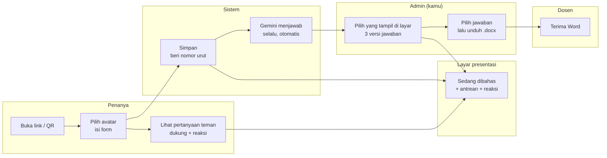

# PRD — Ruang Tanya: Sistem Tanya Jawab Presentasi

4 November 2026 · Mockup yang disetujui: [`docs/mockup.html`](mockup.html) (v2)

## Ringkasan

Ruang Tanya adalah web tanya jawab interaktif untuk presentasi kelas. Penanya mengirim pertanyaan lewat link di grup WA atau QR di layar. Pertanyaan tampil langsung di layar presentasi, AI otomatis menjawabnya, dan admin mengunduh rekap Word yang siap dikirim ke dosen.

**Masalah.** Pertanyaan tercecer di grup WA di antara obrolan lain. Menyalin, merapikan ke Word, lalu mencari jawabannya satu per satu memakan waktu. Sesi tanya jawab juga sering sepi karena teman malu bertanya.

**Tujuan.** Kerja admin setelah sesi tinggal memeriksa, memilih jawaban, lalu mengunduh Word. Sesi tanya jawab terasa seru lewat avatar, dukungan, reaksi, dan podium.

| Ukuran keberhasilan | Target |
| --- | --- |
| Kerja admin dari sesi selesai sampai Word terunduh | 5 menit atau kurang |
| Pertanyaan yang punya jawaban AI | 100%, muncul paling lama 30 detik setelah dikirim |
| Waktu teman mengisi form di HP | 1 menit atau kurang |
| Jeda dari pertanyaan dikirim sampai muncul di layar presentasi | 3 detik atau kurang |
| Biaya bulanan | Rp0, di luar domain yang sudah dimiliki |
| Tampilan | Sesuai mockup v2 "Stiker Kelas", tidak terlihat seperti template AI generik |

## Pengguna & alur

Ada empat pengguna; hanya admin yang perlu login.

| Pengguna | Perangkat | Yang dilakukan |
| --- | --- | --- |
| Penanya (teman sekelas) | HP, lewat link di grup WA atau QR | Memilih avatar, mengirim pertanyaan dan jawaban versinya (opsional), mendukung pertanyaan teman, mengirim reaksi |
| Admin (kamu, satu-satunya) | Laptop | Membuat sesi, memilih pertanyaan yang tampil di layar, memilih jawaban, mengunduh Word |
| Penonton di kelas | Layar proyektor | Melihat pertanyaan yang sedang dibahas, antrean, reaksi, dan podium |
| Dosen | Menerima file | Membaca Word; tidak memakai aplikasi |

Gemini selalu menjawab, termasuk saat penanya sudah menulis jawabannya sendiri. Kamu yang menentukan versi mana yang masuk Word.

## Kebutuhan fungsional

Versi pertama (v1) memuat semua yang ditandai **v1**. Yang ditandai *nanti* boleh menyusul tanpa mengubah struktur data.

**A. Sesi**

1. Admin membuat sesi: topik, mata kuliah, kelompok penyaji, tanggal, dan ringkasan materi (tempel teks, opsional). **v1**
2. Tiap sesi punya link pendek sendiri, misalnya `qna.domainmu.com/akhlak`, plus kode QR. **v1**
3. Status sesi: Draf, Dibuka, Ditutup. Form hanya menerima pertanyaan saat Dibuka; selain itu tampil pesan "Sesi belum dibuka" atau "Sesi sudah ditutup". Feed dan layar tetap bisa dilihat. **v1**
4. Daftar semua sesi, dengan tombol "Duplikat" untuk memakai pengaturan sesi lama. **v1**
5. Unggah file materi (.pptx, .docx, .pdf) yang otomatis diubah jadi teks acuan AI. *nanti*

**B. Form penanya (tanpa login)**

1. Pilih satu dari 12 avatar lewat satu baris yang bisa digeser ke samping, dengan avatar terpilih dan tombol "Acak" di atasnya, supaya form tetap terlihat. Bawaan: avatar acak. **v1**
2. Kolom wajib: Nama, NIM, Kelompok, Pertanyaan. Kolom "Jawaban versimu" opsional, tetapi selalu tampil seperti kolom lain. **v1**
3. Pilihan "Tampil di layar sebagai": nama lengkap atau nama avatar. NIM tidak pernah ditampilkan ke teman atau di layar. **v1**
4. Validasi: NIM hanya angka (5 sampai 20 digit), pertanyaan 10 sampai 1.000 karakter, jawaban penanya paling banyak 3.000 karakter. **v1**
5. Avatar, Nama, NIM, dan Kelompok diingat di HP penanya untuk sesi berikutnya. **v1**
6. Setelah kirim: layar sukses dengan avatar, nomor urut ("Kamu penanya ke-6"), lencana yang didapat, tombol "Lihat pertanyaan teman" dan "Kirim pertanyaan lain". **v1**
7. Anti-spam tanpa CAPTCHA: paling banyak 5 pertanyaan per perangkat per sesi, kolom jebakan bot (honeypot), dan batas kiriman per alamat IP di server. **v1**

**C. Pertanyaan teman (feed penanya)**

1. Daftar semua pertanyaan sesi yang ter-update langsung, dengan tab "Terpopuler" (urut dukungan) dan "Terbaru". **v1**
2. Tiap kartu: avatar, nama tampil, jam, pertanyaan, label "Sedang dibahas" atau "Sudah dijawab". Pertanyaan milik sendiri diberi warna berbeda dan label "Pertanyaanmu". **v1**
3. Tombol "Aku juga penasaran": satu dukungan per perangkat per pertanyaan, bisa dibatalkan; tidak bisa mendukung pertanyaan sendiri. **v1**
4. Bilah reaksi 👏 🔥 🤯 😂 🤲 yang dikirim ke layar presentasi. Paling banyak 1 reaksi per detik per perangkat. **v1**
5. Feed tidak menampilkan jawaban AI, jawaban penanya, atau NIM. **v1**
6. Kartu "Pertanyaanmu" punya tombol **Edit** dan **Tarik**. Pemilik dikenali lewat penanda perangkat. **v1**
7. **Edit** bisa mengubah pertanyaan dan data diri (nama, NIM, kelompok, avatar, tampil sebagai). Pertanyaan yang diedit diberi label "diedit", AI otomatis menjawab ulang, dan dukungan tetap dihitung. Bila admin sudah menulis Versi saya, tulisannya tidak dihapus, tetapi panel menampilkan tanda "Pertanyaan diubah penanya. Cek lagi jawabanmu." **v1**
8. **Tarik** meminta konfirmasi, lalu pertanyaan hilang dari feed, layar, dan Word. Di panel admin pertanyaan tetap terlihat redup dengan label "Ditarik penanya". **v1**
9. Edit dan Tarik terkunci bila pertanyaan sedang dibahas di layar, sudah ditandai dijawab, atau sesi ditutup. Kartu menampilkan alasannya, misalnya "Terkunci: sedang dibahas". Untuk kasus ini, dan bila penanya ganti HP atau menghapus data browser, perubahan dilakukan admin dari panel. **v1**

**D. Layar presentasi (proyektor)**

1. Halaman layar penuh bertema gelap untuk proyektor, rasio 16:9. **v1**
2. Kiri: kartu besar "Sedang dibahas" berisi pertanyaan, avatar, nama tampil, kelompok, dan jumlah dukungan. **v1**
3. Kanan: antrean 5 pertanyaan berikutnya, urut dukungan terbanyak; yang sudah dijawab tampil redup. **v1**
4. Atas: judul sesi, QR dan link untuk ikut bertanya, jumlah pertanyaan. **v1**
5. Pertanyaan baru memunculkan notifikasi singkat "{nama} baru bertanya!". **v1**
6. Reaksi dari HP penanya melayang dari bawah ke atas layar. **v1**
7. Bila admin login: semua antrean bisa digulir dan diklik untuk langsung dibahas; kartu yang sedang dibahas punya tombol "Turunkan". Penonton tanpa login melihat 5 antrean teratas. **v1**
8. Kontrol kecil: "Bahas berikutnya" (tandai yang sekarang sudah dijawab, ambil antrean teratas) dan "Tampilkan podium". **v1**
9. Podium akhir sesi: 3 penanya dengan dukungan terbanyak, dengan animasi. **v1**
10. Jawaban tidak pernah tampil di layar. **v1**

**E. Gamifikasi**

1. 12 avatar: Si Kepo, Kak Ambis, Mas Ngantuk, Bang Santuy, Neng Ceria, Si Paling Kritis, Profesor Mini, Alien Nyasar, Hantu Absen, Raja Nanya, Kucing Oren, Si Kalem. Digambar sebagai SVG di kode, tanpa file gambar. **v1**
2. Lencana "Berani Bertanya" untuk pertanyaan pertama per perangkat per sesi. **v1**
3. Podium penanya terbaik berdasarkan dukungan (lihat D.8). **v1**
4. Lencana tambahan, misalnya "Paling Didukung" dan "Pertanyaan Terpilih" pilihan penyaji. *nanti*

**F. Jawaban AI**

1. Dibuat otomatis begitu pertanyaan masuk, termasuk ketika penanya sudah mengisi jawabannya sendiri. **v1**
2. AI memakai konteks sesi: mata kuliah, topik, dan ringkasan materi. Nama dan NIM penanya tidak dikirim ke AI. **v1**
3. Aturan isi: 40 sampai 90 kata dalam satu paragraf, bahasa Indonesia baku, tanpa markdown. Kalimat pertama langsung menjawab; tanpa salam, ucapan terima kasih, pujian terhadap pertanyaan, atau penutup basa-basi (sistem juga membuang kalimat semacam itu bila tetap muncul). Dalil hanya disebut bila relevan dan rujukannya pasti benar; dilarang mengarang nomor surat, ayat, atau hadits. Masalah khilafiyah disebut perbedaannya secara berimbang. **v1**
4. Bila gagal (kuota habis atau galat), sistem mencoba ulang otomatis hingga 3 kali, lalu menandai "Gagal" dengan tombol "Coba lagi". **v1**
5. Tombol "Buat ulang" per pertanyaan bila jawaban kurang pas. **v1**

**G. Panel admin (login, satu akun: kamu)**

1. Kepala halaman: judul sesi dan tiga angka (pertanyaan, siap Word, total dukungan). **v1**
2. Bilah alat: Buka/Tutup sesi, link + "Salin link", "Pakai AI untuk semua", "Buka layar presentasi", "Pratinjau & unduh Word". **v1**
3. Daftar pertanyaan ter-update langsung, urut waktu masuk. Pertanyaan baru masuk dengan animasi. **v1**
4. Tiap pertanyaan: nomor, avatar, nama, NIM, kelompok, jam, label "tampil sebagai ..." bila memakai nama avatar, jumlah dukungan. **v1**
5. Tombol "Tampilkan di layar" untuk memilih pertanyaan yang sedang dibahas; pertanyaan itu ditandai "Di layar". **v1**
6. Tiga versi jawaban berdampingan: Jawaban AI, Versi penanya, Versi saya. Versi saya bisa ditulis dari nol atau diisi lewat "Salin ke Saya". Tersimpan otomatis. **v1**
7. Pilih satu versi "Masuk Word" per pertanyaan; yang terpilih diberi cap "MASUK WORD". Pilihan bawaan: Versi saya bila terisi, selain itu Jawaban AI. **v1**
8. Menu "lainnya": Tandai sudah/belum dijawab, Ubah pertanyaan / data penanya, Sembunyikan (spam/dobel). Pertanyaan tersembunyi hilang dari feed, layar, dan Word. **v1**
9. Label "diedit penanya" dan "Ditarik penanya" tampil di pertanyaan yang bersangkutan. **v1**
10. Tambah pertanyaan manual untuk pertanyaan lisan atau dari WA. **v1**

**H. Ekspor Word**

1. Halaman pratinjau menampilkan tabel persis seperti di Word, dengan peringatan bila ada pertanyaan tanpa jawaban terpilih. **v1**
2. Tombol "Unduh .docx" menghasilkan file sesuai bagian Format Word. **v1**

## Arah desain UI/UX

Konsepnya **"Stiker Kelas"**: ceria, berani, dan terasa buatan tangan, seperti buku tempel stiker. Mockup v2 adalah acuan visual utama; bila PRD dan mockup berbeda, ikuti mockup.

| Unsur | Keputusan |
| --- | --- |
| Warna dasar | Latar krem terang `#FFFBF2`, kartu putih, tinta `#121212` |
| Warna aksen | Tomat `#FF5B3A` (aksi utama, live), kuning `#FFC93C`, mint `#3DD6B0` (sukses), biru `#5B9DFF`, pink `#FF9ECF` |
| Huruf judul | Bricolage Grotesque, tebal 800 |
| Huruf isi | Plus Jakarta Sans (dibuat oleh studio Indonesia) |
| Label kecil | JetBrains Mono, huruf kapital, renggang |
| Kartu & tombol | Garis 2 px hitam, sudut membulat 12 sampai 22 px, bayangan keras 2 sampai 4 px tanpa blur |
| Avatar | SVG gambar tangan: badan bulat/kotak/blob/hantu, mata dan mulut ekspresif, aksesori (peci, kerudung, mahkota, headphone, telinga kucing, antena) |
| Gerak | Avatar memantul saat dipilih; kartu baru jatuh masuk; cap "MASUK WORD" menghentak; reaksi melayang; podium tumbuh dari bawah. Semua mati bila pengguna memilih "kurangi gerakan" |
| Layar presentasi | Latar `#121212`, kartu "sedang dibahas" tomat, antrean berwarna-warni sedikit miring |
| Ikon & emoji | Emoji hanya untuk reaksi dan penanda dukungan; tidak dipakai sebagai ikon navigasi |

**Dilarang (ciri "AI slop")**

- Gradien ungu-biru, glassmorphism, latar blob buram.
- Bayangan lembut ber-blur di mana-mana.
- Hero di tengah + tiga kartu fitur dengan ikon.
- Inter sebagai satu-satunya font; ilustrasi stok.
- Teks basa-basi seperti "Selamat datang di platform tanya jawab modern!".

**Prinsip UX**

- Halaman penanya dirancang untuk HP lebih dulu; panel admin dan layar presentasi untuk laptop/proyektor.
- Setiap status punya teks jelas: "AI sedang menjawab…", "Gagal: kuota sementara habis.", "Sedang dibahas", "Sudah dijawab".
- Kontras teks minimal 4,5:1 (WCAG AA), kecuali teks dekoratif; semua tombol bisa dipakai lewat keyboard.

## Halaman & layar

| Halaman | Alamat | Pengguna | Isi utama |
| --- | --- | --- | --- |
| Form pertanyaan | `/{kode-sesi}` | Penanya | Kepala sesi, pilihan avatar, form, layar sukses |
| Pertanyaan teman | `/{kode-sesi}/teman` | Penanya | Feed, tombol dukungan, bilah reaksi |
| Layar presentasi | `/{kode-sesi}/layar` | Proyektor | Sedang dibahas, antrean, QR, reaksi, podium. Kontrol hanya muncul bila admin login |
| Login | `/admin/login` | Admin | Email dan password |
| Daftar sesi | `/admin` | Admin | Sesi terbaru di atas, tombol "Sesi baru" dan "Duplikat" |
| Atur sesi | `/admin/sesi/{id}/atur` | Admin | Topik, mata kuliah, kelompok penyaji, tanggal, kode link, ringkasan materi |
| Panel sesi | `/admin/sesi/{id}` | Admin | Lihat Kebutuhan G |
| Pratinjau Word | `/admin/sesi/{id}/word` | Admin | Tabel Word, peringatan, tombol unduh |
| Tidak ditemukan | Semua alamat lain | Semua | Pesan singkat dan tautan kembali |

## Teknologi & biaya

Web berjalan di Vercel (paket Hobby), data di Supabase (paket Free), AI di tier gratis Gemini API, jadi biayanya Rp0 per bulan.

| Bagian | Pilihan | Kuota gratis | Catatan |
| --- | --- | --- | --- |
| Web + API | Next.js (App Router) di Vercel Hobby | Fungsi server berjalan hingga 300 detik per request ([sumber](https://vercel.com/docs/limits)) | Cukup untuk menunggu jawaban Gemini |
| Database | Supabase Postgres | 500 MB database, 5 GB egress, 2 proyek aktif ([sumber](https://supabase.com/pricing)) | **Dijeda setelah 1 minggu tidak aktif** (lihat Risiko) |
| Login admin | Supabase Auth (email + password) | 50.000 pengguna aktif per bulan | Cukup satu akun: kamu |
| Update langsung | Supabase Realtime (Broadcast) | 200 koneksi bersamaan, 2 juta pesan per bulan | Untuk panel, feed, layar, dan reaksi. Satu kelas sekitar 40 HP + 2 layar |
| AI | Gemini API, model `gemini-3.8-flash`, cadangan `gemini-3.5-flash-lite` | Input dan output gratis ([sumber](https://aistudio.google.com/docs/pricing)); batas per menit/hari dilihat di AI Studio ([sumber](https://aistudio.google.com/docs/rate-limits)) | Di tier gratis, data dipakai Google untuk meningkatkan produknya |
| Domain | Subdomain, misalnya `qna.domainmu.com` | Gratis | Cukup tambah satu record CNAME di pengaturan DNS domain |
| Kode | TypeScript: Next.js, `@supabase/supabase-js`, `docx` (Word), `qrcode` | Gratis (open source) | Satu repositori, deploy otomatis dari GitHub |

**Keputusan teknis penting**

- Semua penulisan data (kirim pertanyaan, dukungan, simpan jawaban) lewat API Next.js di server memakai *service role key*. Row Level Security menolak semua akses langsung dari pengunjung anonim.
- Feed dan layar presentasi menerima data lewat Supabase Realtime Broadcast yang dikirim server, berisi kolom publik saja (avatar, nama tampil, pertanyaan, dukungan, status). NIM dan jawaban tidak pernah dikirim ke halaman publik; nama lengkap hanya dikirim bila penanya memilih tampil dengan nama.
- Reaksi tidak disimpan di database; hanya diteruskan lewat Broadcast.
- Penanda perangkat: ID acak yang disimpan di HP penanya (localStorage), dipakai untuk batas kiriman, satu dukungan per pertanyaan, lencana, serta hak Edit dan Tarik.
- Setelah pertanyaan tersimpan, server memanggil Gemini setelah respons dikirim, jadi penanya tidak perlu menunggu. Jawaban yang gagal atau terputus ditandai "menunggu" dan diproses ulang saat panel admin dibuka.
- File Word dibuat di browser admin, supaya server tidak terbebani dan file langsung terunduh.
- API key Gemini dan *service role key* Supabase disimpan sebagai environment variable di Vercel, tidak pernah terkirim ke browser.
- Nama model AI disimpan di pengaturan, bukan di kode. Google rutin mengganti model gratisnya; Gemini 2.5 Flash, misalnya, dialihkan ke model lain mulai 1 Desember 2026.
- Biaya perpanjangan domain milikmu di luar cakupan PRD ini.

## Model data

Tiga tabel. Akun admin dikelola Supabase Auth.

**Tabel `sesi`**

| Kolom | Tipe | Keterangan |
| --- | --- | --- |
| `id` | teks (UUID) | Kunci utama |
| `kode` | teks, unik | Bagian link, misalnya `akhlak` |
| `topik` | teks | Judul presentasi |
| `matkul` | teks | Bawaan: Pendidikan Agama Islam |
| `kelompok_penyaji` | teks | Misalnya "Kelompok 3" |
| `tanggal` | tanggal | Tanggal presentasi |
| `materi` | teks, boleh kosong | Ringkasan materi untuk acuan AI |
| `status` | `draf` / `dibuka` / `ditutup` | Menentukan apakah form menerima kiriman |
| `sorotan_id` | teks, boleh kosong | Pertanyaan yang sedang dibahas di layar |
| `dibuat_pada` | waktu | |

**Tabel `pertanyaan`**

| Kolom | Tipe | Keterangan |
| --- | --- | --- |
| `id` | teks (UUID) | Kunci utama |
| `sesi_id` | teks | Mengacu ke `sesi.id` |
| `nomor` | angka | Urutan dalam sesi, mulai 1 |
| `nama`, `nim`, `kelompok` | teks | Data penanya |
| `avatar` | angka 0 sampai 11 | Avatar pilihan |
| `tampil_sebagai` | `nama` / `avatar` | Nama yang tampil di feed dan layar |
| `pertanyaan` | teks | |
| `jawaban_penanya` | teks, boleh kosong | Versi penanya |
| `jawaban_ai` | teks, boleh kosong | Versi AI |
| `status_ai` | `menunggu` / `memproses` / `selesai` / `gagal` | |
| `ai_percobaan` | angka | Jumlah percobaan, paling banyak 3 otomatis |
| `ai_model` | teks | Model yang menghasilkan jawaban |
| `jawaban_admin` | teks, boleh kosong | Versi saya |
| `pilihan_word` | `ai` / `penanya` / `admin`, boleh kosong | Kosong berarti pakai aturan bawaan |
| `jumlah_dukungan` | angka | Salinan hitungan dari tabel `dukungan`, untuk urutan cepat |
| `sudah_dijawab` | ya/tidak | Label di feed dan layar |
| `disembunyikan` | ya/tidak | Disembunyikan admin; tidak tampil di feed, layar, dan Word |
| `ditarik` | ya/tidak | Ditarik penanya; tidak tampil di feed, layar, dan Word |
| `diedit` | ya/tidak | Pertanyaan pernah diubah penanya |
| `perlu_dicek` | ya/tidak | Pertanyaan diubah setelah admin menulis Versi saya; hilang saat admin mengubah jawabannya |
| `perangkat` | teks | Penanda perangkat pengirim |
| `dibuat_pada`, `diubah_pada` | waktu | |

**Tabel `dukungan`**

| Kolom | Tipe | Keterangan |
| --- | --- | --- |
| `pertanyaan_id` | teks | Mengacu ke `pertanyaan.id` |
| `perangkat` | teks | Penanda perangkat pendukung |
| `dibuat_pada` | waktu | |

Pasangan `pertanyaan_id` + `perangkat` unik, jadi satu perangkat hanya bisa mendukung sekali.

## Format Word

Word berisi satu tabel rapi berformat akademik, siap dikirim tanpa diedit lagi. Isi Word memakai gaya akademik biasa, bukan gaya "Stiker Kelas" aplikasi. Avatar, dukungan, dan reaksi tidak ikut.

- **Kertas:** A4 landscape, margin 2 cm. Huruf Times New Roman, 12 pt untuk kepala dokumen dan 11 pt di tabel.
- **Judul:** "REKAPITULASI SESI TANYA JAWAB", tebal, rata tengah.
- **Identitas:** Mata Kuliah, Topik, Kelompok Penyaji, Tanggal (contoh: 10 November 2026), Jumlah Pertanyaan.
- **Tabel:** No, Nama (nama lengkap asli), NIM, Kelompok, Pertanyaan, Jawaban. Baris judul diberi warna dan diulang di tiap halaman. Pertanyaan dan jawaban rata kiri-kanan.
- **Isi kolom Jawaban:** versi yang dipilih admin saja; label versinya tidak ikut dicetak. Pertanyaan yang disembunyikan tidak ikut.
- **Nama file:** `Rekap_Tanya_Jawab_{topik}_{tanggal}.docx`.

## Kualitas, risiko, dan batasan

**Kebutuhan non-fungsional**

- Form penanya terbuka dalam 2 detik di HP dengan sinyal 4G biasa.
- Tahan 60 penanya aktif bersamaan dalam satu sesi, termasuk dukungan dan reaksi.
- Pertanyaan baru, dukungan, dan sorotan muncul di layar presentasi paling lambat 3 detik.
- NIM dan jawaban hanya terlihat oleh admin.
- Panel admin terkunci login; sesi login berlaku 30 hari di perangkat yang sama.
- Semua teks antarmuka dalam bahasa Indonesia.

**Risiko**

| Risiko | Akibat | Penanganan |
| --- | --- | --- |
| Supabase menjeda proyek setelah 1 minggu tidak dipakai | Link form error tepat di hari presentasi | Risiko diterima. Sehari sebelum presentasi, buka dashboard Supabase dan klik Restore bila proyek dijeda (butuh beberapa menit). Halaman menampilkan pesan jelas bila database tidak bisa dihubungi |
| Pertanyaan atau nama iseng tampil di layar proyektor | Malu di depan dosen | Admin bisa menyembunyikan pertanyaan seketika; penanya bisa memilih tampil dengan nama avatar |
| Spam tanpa CAPTCHA | Rekap dan layar kotor | Batas 5 kiriman per perangkat, honeypot, batas per IP, tombol sembunyikan |
| Jawaban AI salah menyebut ayat atau hadits | Nilai turun, kesan buruk ke dosen | Aturan larangan mengarang rujukan; admin membaca sekilas sebelum unduh; jawaban mudah disalin lalu diedit |
| Kuota gratis Gemini habis atau model gratis diganti Google | Jawaban AI tidak muncul | Coba ulang otomatis; model cadangan; nama model bisa diganti di pengaturan |
| Penanya menarik pertanyaan setelah admin menulis jawaban | Kerja admin terbuang | Pertanyaan tetap terlihat di panel dengan label "Ditarik penanya"; admin bisa menampilkannya lagi bila perlu |
| Teman tetap bertanya di grup WA | Pertanyaan tidak tercatat | QR di layar presentasi dan link di grup; admin bisa menambah pertanyaan manual |
| Dukungan dicurangi dengan membuka banyak browser | Podium tidak adil | Diterima untuk v1; podium hanya untuk seru-seruan |

**Di luar cakupan v1**

- Akun untuk penanya dan polling.
- Lebih dari satu admin.
- Ekspor PDF (Word bisa disimpan sebagai PDF dari Word sendiri).
- Membaca chat WA secara otomatis.

## Tahapan & kriteria selesai

1. **Mockup yang bisa diklik:** selesai dan disetujui ([`docs/mockup.html`](mockup.html), v2).
2. **Fondasi:** proyek Next.js di Vercel + Supabase, skema database dan Row Level Security, login admin, komponen dasar sesuai gaya "Stiker Kelas", 12 avatar SVG.
3. **Sesi dan form penanya:** buat/duplikat sesi, link + QR, buka/tutup, form dengan avatar, validasi, anti-spam, layar sukses + lencana.
4. **Realtime:** feed pertanyaan teman, dukungan, reaksi, layar presentasi, sorotan, podium.
5. **Jawaban AI:** panggilan Gemini, coba ulang, model cadangan, tombol buat ulang.
6. **Panel admin:** tiga versi jawaban, pilih "Masuk Word", edit, tandai dijawab, sembunyikan, tambah manual.
7. **Ekspor Word:** pratinjau dan unduh .docx.
8. **Uji coba:** simulasi 30 pertanyaan dari beberapa HP sambil layar presentasi terbuka, pasang domain, uji kecil dengan 2 atau 3 teman.

**Yang perlu disiapkan (semua gratis):** akun GitHub, Vercel, dan Supabase; API key Gemini dari Google AI Studio; akses ke pengaturan DNS domain.

**Kriteria selesai v1**

- [ ] Teman bisa membuka link dari WA atau QR, memilih avatar, dan mengirim pertanyaan dalam 1 menit tanpa login.
- [ ] Pertanyaan baru muncul di feed, panel, dan layar presentasi paling lambat 3 detik.
- [ ] Dukungan mengubah urutan antrean; reaksi melayang di layar; podium menampilkan 3 penanya teratas.
- [ ] Jawaban AI muncul di panel paling lambat 30 detik setelah pertanyaan dikirim.
- [ ] Tiap pertanyaan menampilkan versi AI, Penanya, dan Saya; pilihan "Masuk Word" tersimpan.
- [ ] Word yang diunduh terbuka rapi di Microsoft Word dan Google Docs, dengan isi sesuai pilihan.
- [ ] NIM tidak pernah muncul di feed atau layar presentasi.
- [ ] Penanya bisa mengedit atau menarik pertanyaannya sendiri, dan keduanya terkunci saat sedang dibahas, sudah dijawab, atau sesi ditutup.
- [ ] Sesi bisa dibuat ulang untuk presentasi berikutnya tanpa menyentuh kode.
- [ ] Tagihan Vercel, Supabase, dan Google tetap Rp0 setelah satu sesi penuh.

## Sumber

Dibuka pada 3–4 November 2026.

- [Vercel: batas paket](https://vercel.com/docs/limits)
- [Supabase: harga, kuota gratis, dan jeda proyek](https://supabase.com/pricing)
- [Gemini API: harga dan model tier gratis](https://aistudio.google.com/docs/pricing)
- [Gemini API: batas pemakaian](https://aistudio.google.com/docs/rate-limits)
